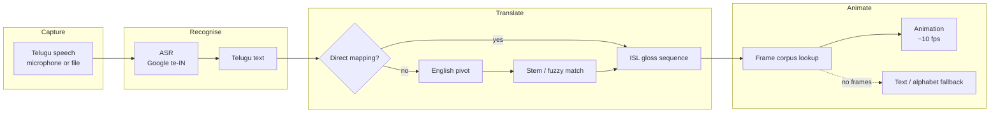
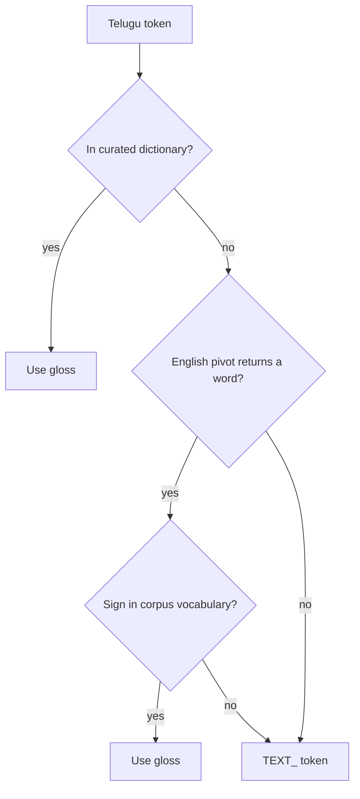
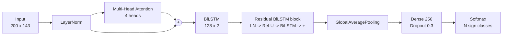
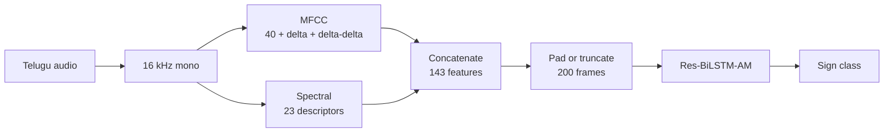
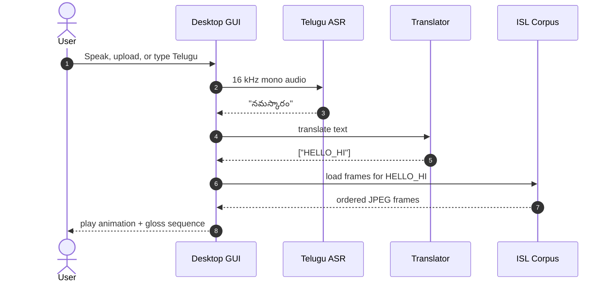

# Telugu Speech → Indian Sign Language

**A speech-to-sign translation framework for Telugu, built around a residual bidirectional LSTM with attention.**

Turn spoken Telugu into an ordered Indian Sign Language (ISL) gloss sequence, then play the matching sign frames in a desktop interface. The project implements the pipeline described in *“Speech-to-Sign Language Translation Framework for Telugu Language using Residual Bidirectional LSTM with Attention Network”* (ICSCSA 2025), with a practical dictionary-first runtime and a trainable acoustic-model branch.


**Documentation:** [Setup guide](docs/SETUP.md) · [Architecture & knowledge base](docs/ARCHITECTURE.md) · [Paper notes](docs/PAPER_NOTES.md) · [Data layout](data/README.md) · [Original paper](docs/paper/speech-to-sign-res-bilstm-am.pdf)

---

## What this project does

Most assistive speech tools stop at transcription. This project goes one step further:

1. **Listens** to Telugu speech from a microphone or an audio file.
2. **Recognises** the spoken words with Telugu ASR (`te-IN`).
3. **Translates** the Telugu text into ISL glosses using a curated dictionary, an English pivot, and fuzzy stem matching.
4. **Animates** each gloss with ordered frames from an ISL corpus.
5. **Falls back gracefully** to a large text card or alphabet spelling when a sign is missing.

The result is a desktop application that shows the recognised Telugu, the ISL gloss sequence, and the sign animation side by side.

| | |
|---|---|
| **Input** | Telugu speech (microphone / WAV / MP3) or typed Telugu text |
| **Runtime recognition** | Google Speech Recognition, `te-IN` |
| **Research recogniser** | Res-BiLSTM-AM trained on dual audio features |
| **Translation** | 214-entry curated mapping + English pivot + stem matching |
| **Output** | ISL gloss sequence + ordered frame animation (~10 fps) |
| **Fallback** | Text card / alphabet when no sign frames exist |
| **Interface** | Tkinter desktop app |
| **Corpus** | Bring-your-own ISL word-level frame corpus |

---

## How it works



The runtime path is intentionally lightweight: it needs no local GPU and no custom model checkpoint. The paper's acoustic model is implemented and trainable in parallel for experiments and for a fully learned recognition branch.

> The diagrams in this README are Mermaid code blocks. GitHub and GitLab render them automatically — no image files, HTML or build step. For local previews, use the Mermaid Live Editor or the “Markdown Preview Mermaid Support” extension in VS Code.

For the component-by-component design, contracts and failure modes, see [Architecture & knowledge base](docs/ARCHITECTURE.md).

### The translation layers

| Layer | When it runs | Example |
|---|---|---|
| **Direct mapping** | The Telugu token is in the curated dictionary | `నమస్కారం` → `HELLO_HI` |
| **English pivot** | No direct entry, but an English translation is available | `ఆనందం` → `happiness` → `HAPPY` |
| **Fuzzy / stem match** | The English word needs normalisation | `going` → `go`, `happily` → `happy` |
| **Text fallback** | Nothing matches | `వైద్యుడు` → `TEXT_వైద్యుడు` → text card |



The fallback is deliberate: **a missing sign must never hide the meaning of the sentence.** The UI shows the untranslated word as a text card instead of silently dropping it.

---

## The model: Res-BiLSTM-AM

The acoustic branch follows the paper's architecture:



The input is **143 features per frame**:

| Feature group | Count |
|---|---:|
| MFCC (40) + delta (40) + delta-delta (40) | 120 |
| Spectral centroid, bandwidth, rolloff, zero-crossing rate | 4 |
| Spectral contrast (7 bands) + chroma (12 pitch classes) | 19 |
| **Total** | **143** |

Sequences are padded or truncated to **200 frames**. Training uses Adam (`1e-3`), sparse categorical cross-entropy, early stopping, best-checkpoint saving, and learning-rate reduction on plateau. The paper's evaluation split is reproduced as **75% train / 25% test**.



> The GUI's default path uses Google ASR plus the dictionary translator. The Res-BiLSTM-AM branch is a trainable alternative, not a pretrained model shipped in this repository. See [Paper notes](docs/PAPER_NOTES.md) for the exact mapping between the paper and this codebase.

---

## Runtime sequence



---

## Desktop interface

The Tkinter window is deliberately plain so the sign animation stays the focus:

| Left panel | Right panel |
|---|---|
| Record / Upload buttons | 400 × 400 frame display |
| Telugu text entry | Play/Pause, Stop, Reset |
| Recognised Telugu | Current sign label |
| ISL translation | Sign sequence |

The status bar reports recording, processing, playback and fallback states. If the frame corpus is missing, the right panel shows a readable text card for the missing sign instead of a blank animation.

---

## Repository layout

```text
aiml/
├── app.py                        # Entry point: python app.py
├── pyproject.toml                # Packaging + pytest config
├── requirements.txt              # Runtime dependencies
├── requirements-train.txt        # TensorFlow training dependencies
├── requirements-dev.txt          # pytest
├── telugu_s2sl/
│   ├── config.py                 # Paths, audio/model config, seed vocabulary
│   ├── pipeline.py               # SpeechToSignPipeline orchestration
│   ├── cli.py                    # argparse CLI
│   ├── audio/
│   │   ├── asr.py                # Google te-IN speech recognition
│   │   └── features.py           # MFCC + spectral dual features
│   ├── nlp/
│   │   └── translator.py         # Direct map, English pivot, fuzzy match
│   ├── animation/
│   │   ├── corpus.py             # Frame indexing, caching, playback records
│   │   └── gif.py                # Optional GIF fallback + placeholders
│   ├── model/
│   │   ├── res_bilstm_am.py      # Res-BiLSTM-AM architecture
│   │   └── inference.py          # Trained-checkpoint inference wrapper
│   ├── training/
│   │   └── train.py              # Dataset loading + training loop
│   ├── data/
│   │   └── prepare.py            # Corpus indexing + generated mappings
│   └── gui/
│       └── app.py                # Tkinter desktop interface
├── data/
│   ├── mappings/telugu_to_isl.json
│   ├── audio/                    # optional, gitignored
│   ├── gifs/                     # optional, gitignored
│   └── ISL_Corpus/Frames_Word_Level/  # optional, gitignored
├── docs/
│   ├── SETUP.md                  # Full installation + troubleshooting
│   ├── ARCHITECTURE.md           # Component design and failure modes
│   ├── PAPER_NOTES.md            # Paper summary and implementation map
│   └── paper/                    # Original ICSCSA 2025 PDF
├── scripts/
│   ├── run_app.bat               # Windows launcher
│   └── run_app.sh                # macOS / Linux launcher
├── tests/                        # Offline pytest suite
└── models/trained/               # checkpoints, gitignored
```

---

## Quick start

### 1. Clone and create an environment

**Windows (PowerShell)**

```powershell
git clone <your-repo-url> aiml
cd aiml
py -3.11 -m venv .venv
.\.venv\Scripts\Activate.ps1
python -m pip install --upgrade pip
pip install -r requirements.txt
```

**macOS / Linux**

```bash
git clone <your-repo-url> aiml
cd aiml
python3.11 -m venv .venv
source .venv/bin/activate
python -m pip install --upgrade pip
pip install -r requirements.txt
```

> Use **Python 3.10–3.12**. Python 3.13 can run the GUI and translator, but TensorFlow wheels may not be available yet.

### 2. (Optional) install the training stack

```bash
pip install -r requirements-train.txt
```

This adds TensorFlow, Keras, scikit-learn, tqdm and matplotlib. The GUI does **not** need TensorFlow.

### 3. Add the ISL corpus

The curated mapping is included, but the frame corpus is not. Put your word-level frames here:

```text
data/ISL_Corpus/Frames_Word_Level/
├── HELLO_HI/
│   ├── 001.jpg
│   ├── 002.jpg
│   └── ...
├── THANK/
└── ...
```

The directory name is the ISL gloss. See [data/README.md](data/README.md) for naming rules and supported formats.

Without a corpus the app still starts and shows text cards for every sign. That is the intended fallback, not a crash.

### 4. Run

```bash
python app.py
```

On Windows you can also double-click `scripts\run_app.bat`.

### 5. Check what the runtime sees

```bash
python app.py --mode info
```

This prints the number of loaded mappings, indexed signs, corpus frames, and the ASR backend.

---

## Commands

| Command | What it does |
|---|---|
| `python app.py` | Launch the desktop GUI |
| `python app.py --translate "నమస్కారం"` | Translate Telugu text to ISL gloss |
| `python app.py --audio path/to/file.wav` | Transcribe an audio file and translate it |
| `python app.py --mode prepare` | Index the frame corpus and generate lookup files |
| `python app.py --mode info` | Show mapping / corpus / ASR summary |
| `python app.py --mode train` | Train Res-BiLSTM-AM |
| `python app.py --mode classify --audio file.wav` | Classify a clip with a trained checkpoint |
| `python app.py --mode test` | Run the pytest suite |
| `pytest -q` | Run tests directly |

### Text example

```bash
$ python app.py --translate "నమస్కారం ధన్యవాదాలు"

Telugu → ISL
Input: నమస్కారం ధన్యవాదాలు

  నమస్కారం             → hello_hi             [✓ direct]
  ధన్యవాదాలు           → thank                [✓ direct]

Gloss: hello_hi → thank
Animation: 0 ready, 2 text fallback(s)   # after adding the corpus: 2 ready
```

### Audio example

```bash
python app.py --audio samples/greeting.wav
```

---

## Setup guide

The short version is above. The complete guide covers Python versions, virtual environments, PyAudio/PortAudio, microphone permissions, TensorFlow, data layout, environment variables, and troubleshooting:

**→ [docs/SETUP.md](docs/SETUP.md)**

Common issues:

| Symptom | Fix |
|---|---|
| `ModuleNotFoundError: speech_recognition` | `pip install -r requirements.txt` |
| PyAudio build fails on Windows | `pip install pipwin && pipwin install pyaudio` |
| PyAudio fails on macOS | `brew install portaudio && pip install pyaudio` |
| PyAudio fails on Linux | `sudo apt install portaudio19-dev python3-dev` |
| `No ISL frame corpus` | Add frames under `data/ISL_Corpus/Frames_Word_Level/` or accept text fallback |
| Google API request error | Check internet / firewall; ASR and the English pivot are online |
| TensorFlow import error | `pip install -r requirements-train.txt` |
| Tkinter missing on Linux | `sudo apt install python3-tk` |
| Garbled Telugu in a terminal | Use Windows Terminal or `chcp 65001` |

---

## Training

```bash
pip install -r requirements-train.txt
python app.py --mode train
```

The trainer looks for an OpenSLR-style Telugu audio layout:

```text
data/audio/
├── female/
│   ├── line_index_female.tsv    # file_id <TAB> Telugu sentence
│   └── *.wav
└── male/
    ├── line_index_male.tsv
    └── *.wav
```

If fewer than 10 audio files are present, the pipeline falls back to **synthetic data** so you can smoke-test the training loop. Synthetic results are meaningless as a model; use real labelled audio for anything you intend to report.

Artefacts are written to `models/trained/`:

- `res_bilstm_am_best.keras` — best validation checkpoint
- `res_bilstm_am_final.keras` — final epoch
- `training_history.json`
- `class_mapping.json` — class names, Telugu-to-class map, input shape

Then classify a clip:

```bash
python app.py --mode classify --audio path/to/clip.wav
```

---

## Tests

```bash
pytest -q
```

The suite is offline and uses temporary frame directories, so it does not need the real corpus or network access. The model test is skipped automatically if TensorFlow is not installed.

| Test file | Covers |
|---|---|
| `tests/test_features.py` | MFCC, spectral, dual-feature shapes |
| `tests/test_translation.py` | Tokenisation, direct map, fallback markers |
| `tests/test_animation.py` | Frame indexing, ordering, text fallback |
| `tests/test_pipeline.py` | End-to-end text → gloss → animation bundle |
| `tests/test_model.py` | Res-BiLSTM-AM forward pass |
| `tests/test_utils.py` | Telugu text helpers |

---

## Paper vs. this repository

The paper describes a complete S2SLT framework. This repository is an implementation of that framework with a pragmatic runtime split:

| Paper component | In this repo | Notes |
|---|---|---|
| Telugu audio capture | `telugu_s2sl/audio/asr.py`, GUI | Mic or file upload |
| Spectral + MFCC features | `telugu_s2sl/audio/features.py` | 143-dimensional dual features |
| Res-BiLSTM-AM | `telugu_s2sl/model/res_bilstm_am.py` | Trainable; no pretrained checkpoint shipped |
| Sign-text prediction | Res-BiLSTM-AM classifier branch | `python app.py --mode classify` |
| Text-to-sign matching | `telugu_s2sl/nlp/translator.py` | Dictionary + English pivot + stemming |
| GIF / animation dataset | `telugu_s2sl/animation/corpus.py`, `gif.py` | Frame corpus preferred; GIFs optional |
| GUI fallback | `telugu_s2sl/gui/app.py` | Text card and alphabet fallback |
| Reported metrics | Not reproduced | The paper reports ESTOI 97.2%, PCC 96.1%, etc.; this repo does not claim those numbers |

The honest summary: **the runtime is production-shaped, the model branch is research-shaped.** The default app does not pretend that a synthetic or unlabeled model is a trained Telugu recogniser.

See [docs/PAPER_NOTES.md](docs/PAPER_NOTES.md) for a section-by-section reading of the paper and [docs/ARCHITECTURE.md](docs/ARCHITECTURE.md) for component-level design details.

---

## Limitations

- **Word-level, not continuous.** The output is a sequence of glosses with frame playback, not a continuous signing avatar.
- **Dictionary coverage.** The shipped mapping has 214 Telugu entries. Words outside it depend on the English pivot and the corpus vocabulary.
- **Simplified grammar.** Telugu and ISL both prefer SOV order, so the runtime preserves token order. It does not yet model ISL non-manual features, classifiers, or spatial grammar.
- **Online dependencies.** Google ASR and the English pivot require internet access. Direct dictionary translation and animation playback work offline.
- **Corpus licensing.** The ISL frame corpus is not redistributed. Check the licence of any corpus you add.
- **No pretrained model.** The Res-BiLSTM-AM checkpoint must be trained on labelled Telugu/ISL audio before `--mode classify` is meaningful.

---

## Roadmap

- Add a larger, licensed ISL frame corpus and expand the Telugu mapping.
- Wire the trained Res-BiLSTM-AM classifier into the GUI as a selectable recognition backend.
- Add ISL grammar transformations (time-first ordering, copula dropping, question markers).
- Add non-manual feature overlays (facial expression, head movement).
- Export sequences as video/GIF for sharing.
- Add a web UI and a mobile-friendly playback surface.
- Build an evaluation harness for WER, gloss accuracy, and playback coverage.

---

## Citation

```bibtex
@inproceedings{mahalakshmi2025speech,
  title     = {Speech-to-Sign Language Translation Framework for Telugu Language
               using Residual Bidirectional LSTM with Attention Network},
  author    = {Mahalakshmi, B. K. V. P. S. and Anuradha, S.},
  booktitle = {2025 5th International Conference on Soft Computing for Security
               Applications (ICSCSA)},
  year      = {2025},
  doi       = {10.1109/ICSCSA66339.2025.11170908}
}
```

The original paper is included at [docs/paper/speech-to-sign-res-bilstm-am.pdf](docs/paper/speech-to-sign-res-bilstm-am.pdf).

---

## Acknowledgements

- The ICSCSA 2025 authors for the S2SLT framework and the Res-BiLSTM-AM architecture.
- The Indian Sign Language corpus contributors whose frame data makes the animation layer possible.
- The open-source Python, TensorFlow, librosa, Pillow, and Tkinter communities.

---

*Academic capstone project. Add a licence before redistributing the code or any bundled data.*
