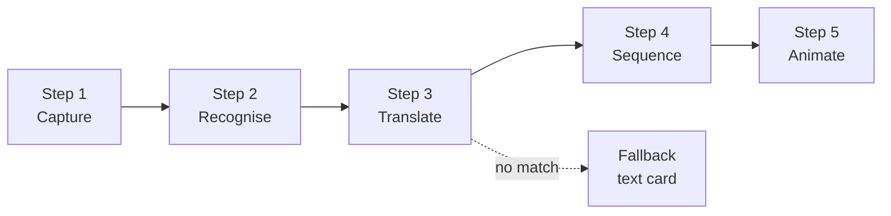
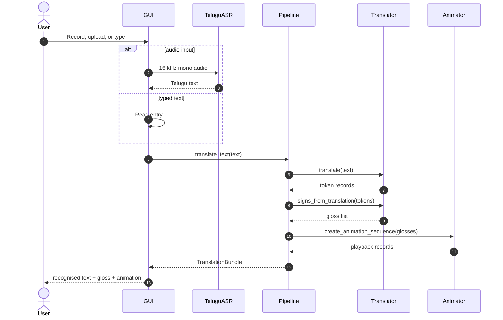

# Architecture

This is the system knowledge base for the Telugu speech-to-ISL framework. It answers three questions in order:

1. **What is the whole system?** — the five-step flow at the top.
2. **How does each part work?** — component responsibilities, APIs and contracts.
3. **What belongs in the knowledge base?** — the durable information future contributors need.

**Related documents:** [README](../README.md) · [Setup guide](SETUP.md) · [Paper notes](PAPER_NOTES.md) · [Data layout](../data/README.md) · [Original paper](paper/speech-to-sign-res-bilstm-am.pdf)

---

## Overall architecture



One sentence: **Telugu audio or text becomes a short ISL gloss sequence, and each gloss resolves to an ordered set of sign frames.** If a gloss has no frames, the system shows a text card instead of dropping the word.

| Step | Input | Output | Main code |
|---|---|---|---|
| 1. Capture | Microphone, audio file, or typed text | 16 kHz mono signal or a text string | `gui/app.py`, `audio/asr.py` |
| 2. Recognise | Audio | Telugu transcript | `audio/asr.py` |
| 3. Translate | Telugu text | ISL gloss tokens | `nlp/translator.py` |
| 4. Sequence | Gloss tokens | Ordered playback records | `animation/corpus.py`, `pipeline.py` |
| 5. Animate | Playback records | Frames on screen at ~10 fps | `gui/app.py` |
| Fallback | Unmatched token | Text card / alphabet spelling | `gui/app.py`, `nlp/translator.py` |

---

## How it works

### Step 1 — Capture

The GUI offers three entry points:

- **Record** — microphone input through `SpeechRecognition` and PyAudio.
- **Upload** — WAV, MP3, FLAC or OGG files.
- **Type** — Telugu text typed into the entry field.

Audio is normalised to **16 kHz mono**. WAV-like files go directly to the recogniser; other formats are decoded with librosa first. The app does not write a permanent copy of recorded audio.

**If it fails:** the status bar shows a friendly message. A missing microphone does not crash the application.

### Step 2 — Recognise

`TeluguASR` wraps Google Speech Recognition with `language="te-IN"`. It calibrates ambient noise for about a second, records one phrase, and returns UTF-8 Telugu text.

```python
text = asr.recognize_from_microphone()
# "నమస్కారం"
```

The paper's alternative is the Res-BiLSTM-AM classifier, which operates on acoustic features rather than a transcript. That branch is implemented under `telugu_s2sl/model/` and is optional.

**If it fails:** timeouts, unknown speech and API errors return a bracketed message such as `[API లోపం - API Error]` rather than raising into the UI.

### Step 3 — Translate

`TeluguNLPTranslator` uses three layers:

1. **Direct mapping** — the curated 214-entry dictionary.
2. **English pivot** — Telugu → English when no direct entry exists.
3. **Fuzzy / stem matching** — `going → go`, `happily → happy`, plus a conservative substring fallback.

Direct hits are deterministic and work offline. The pivot and fuzzy layers increase coverage at the cost of an online call and some semantic loss.

**If it fails:** the token becomes a `TEXT_` marker, which the UI renders as a text card.

### Step 4 — Sequence

The translator returns a gloss list such as `["hello_hi", "thank"]`. `SpeechToSignPipeline` passes that list to `ISLCorpusAnimator`, which:

- normalises the gloss to a directory key,
- checks the frame index,
- loads frames lazily,
- caches decoded images,
- returns playback records with metadata.

The sequence is the seam between language and rendering. A different renderer only needs to accept the same gloss list.

**If it fails:** a missing directory or empty frame set produces a `text` record with `available: false`.

### Step 5 — Animate

The GUI runs a single Tk `after()` loop at roughly **10 fps**. It keeps one frame reference alive (`self._photo`) to avoid the classic blank-Tk-image bug, and advances through the current sign before moving to the next record.

A text fallback is held for about **900 ms** so it is readable. The Play/Pause button toggles the same clock; a new sentence restarts playback instead of pausing it.

**If it fails:** unreadable frames are skipped; the rest of the sequence still plays.

### Fallback

The fallback is a first-class part of the architecture, not an error state:

- `TEXT_` tokens become a large text card.
- Unmatched direct glosses with no frames also become text cards.
- The translator can expose Telugu characters for alphabet spelling.

The rule is simple: **a missing sign must never hide the meaning of the sentence.**

---

## Components

| Component | Path | Responsibility | Owns | Does not own |
|---|---|---|---|---|
| Entry point | `app.py` | Thin wrapper around the CLI | Process start | Business logic |
| CLI | `telugu_s2sl/cli.py` | Modes, arguments, printing | User commands | Translation rules |
| GUI | `telugu_s2sl/gui/app.py` | Window, threading, playback clock | Presentation | ASR or corpus logic |
| Pipeline | `telugu_s2sl/pipeline.py` | Orchestration seam | End-to-end bundle | Low-level decoding |
| Config | `telugu_s2sl/config.py` | Paths, audio/model settings, seed vocabulary | Defaults | Secrets |
| ASR | `telugu_s2sl/audio/asr.py` | Telugu speech recognition | Audio → text | Translation |
| Features | `telugu_s2sl/audio/features.py` | MFCC + spectral extraction | 143-dim contract | Classification |
| Translator | `telugu_s2sl/nlp/translator.py` | Telugu → ISL gloss | Mapping, pivot, stemming | Frame loading |
| Corpus animator | `telugu_s2sl/animation/corpus.py` | Frame indexing, caching, playback records | Sign → frames | UI rendering |
| GIF animator | `telugu_s2sl/animation/gif.py` | Optional GIF fallback | GIF loading | Primary runtime |
| Model | `telugu_s2sl/model/res_bilstm_am.py` | Res-BiLSTM-AM | Training/inference graph | Data collection |
| Inference | `telugu_s2sl/model/inference.py` | Checkpoint wrapper | Class prediction | UI |
| Training | `telugu_s2sl/training/train.py` | Dataset + training loop | Training artefacts | Runtime serving |
| Data prep | `telugu_s2sl/data/prepare.py` | Corpus indexing | Generated mappings | Hand-curated mapping |

### Entry points

`app.py` delegates to `telugu_s2sl.cli.main()`. The CLI exposes GUI, text, audio, prepare, info, train, classify and test modes. The GUI is a separate module so it can be replaced without touching the pipeline.

### Pipeline

`SpeechToSignPipeline` is the only object the UI and CLI need:

```python
pipeline = SpeechToSignPipeline()
bundle = pipeline.translate_text("నమస్కారం")
bundle.signs       # ['hello_hi']
bundle.animation   # playback records with frames
```

`TranslationBundle` carries `source_text`, `tokens`, `signs`, and `animation`. The `tokens` records use `direct_match`, `type` and `sign` so the UI can render direct hits differently from fallbacks.

### Input layer

`TeluguASR` owns the online speech path. `AudioFeatureExtractor` owns the offline acoustic path. They are deliberately separate: the runtime does not need TensorFlow, and the model branch does not need a transcript.

### Language layer

`TeluguNLPTranslator` loads:

- `data/mappings/telugu_to_isl.json` — the curated mapping.
- `data/mappings/telugu_to_isl_corpus.json` — generated corpus mapping, if present.
- `data/mappings/isl_corpus_signs.json` — generated keyword index, if present.

The translator caches results per input string, so calling `translate()` and `get_sign_sequence()` on the same sentence does not repeat network calls.

### Output layer

`ISLCorpusAnimator` indexes sign directories and caches decoded frames. It does not know about Tkinter. `SignAnimator` is the optional GIF path. A 3D avatar or web renderer can replace either by implementing `create_animation_sequence()`.

### Research layer

`model/res_bilstm_am.py` contains the architecture; `training/train.py` contains the training loop; `model/inference.py` loads a checkpoint and class map. The model branch is intentionally not the default runtime because no pretrained Telugu/ISL checkpoint is shipped.

### Data preparation

`data/prepare.py` scans `data/ISL_Corpus/Frames_Word_Level`, writes the sign database, the corpus mapping and the lookup index. These files are generated, gitignored, and safe to delete.

### GUI

The GUI owns threading and presentation only:

- recording runs in a worker thread,
- UI updates are marshalled back with `root.after(0, ...)`,
- animation is a single `after()` clock,
- the pipeline is called synchronously for translation.

---

## Contracts

These are the interfaces that must stay stable when you swap a component.

| Contract | Shape / rule |
|---|---|
| Audio | 16 kHz, mono, float samples in `[-1, 1]` |
| Feature vector | `(frames, 143)` after transpose/pad |
| Model input | `(200, 143)` |
| Mapping file | JSON object: `Telugu word -> ISL gloss` |
| Frame directory | Directory name is the gloss; frames sorted by first integer |
| Frame formats | `.jpg`, `.jpeg`, `.png` |
| Token record | `telugu`, `sign`, `direct_match`, optional `type`, `english` |
| Animation record | `type`, `available`, `frames`, `isl_sign`, `frame_count` |
| Fallback marker | `TEXT_<word>` in the gloss list |

---

## Request lifecycle



---

## Failure modes

| Failure | Detection | Behaviour |
|---|---|---|
| No microphone / PyAudio missing | Import or `Microphone()` error | Friendly message in the transcript box |
| ASR timeout | `sr.WaitTimeoutError` | `[సమయం ముగిసింది - Timeout]` |
| Google API unreachable | `sr.RequestError` | `[API లోపం - API Error]` |
| No ISL corpus | `frames_dir.exists()` is false | Text fallback for every sign |
| Empty sign directory | Frame count is zero | Directory is not indexed |
| Unreadable frame | Pillow exception | Frame skipped; rest play |
| Unknown Telugu word | No dictionary / bridge match | `TEXT_` marker + text card |
| Missing checkpoint | `Path.exists()` is false | Clear error telling you to train |
| TensorFlow absent | Import error in training/inference | Runtime GUI still works |

The design principle is **degrade, don't crash**.

---

## What belongs in this knowledge base

A knowledge base is not a folder of every file. It is the **durable, searchable explanation** of how the system works, why it works that way, and how to operate it. If a future contributor would ask the question twice, the answer belongs here.

### Information that belongs

| Kind of information | What to write | Where it lives |
|---|---|---|
| **Orientation** | What the project does, who it is for, what is in/out of scope | `README.md` |
| **Architecture** | Components, boundaries, data flow, contracts | `docs/ARCHITECTURE.md` |
| **Setup / runbook** | Install, configure, run, verify, troubleshoot | `docs/SETUP.md` |
| **Data contracts** | Folder layout, naming rules, formats, licensing | `data/README.md` |
| **Research context** | Paper summary, model details, reported metrics, caveats | `docs/PAPER_NOTES.md` |
| **Design decisions** | Why dictionary-first, why text fallback, why frames over GIFs | `docs/ARCHITECTURE.md` §Design decisions |
| **Failure modes** | What breaks, how it is detected, what the user sees | `docs/ARCHITECTURE.md` §Failure modes |
| **Evaluation** | Datasets, split, metrics, what was actually measured, what was not | `docs/PAPER_NOTES.md` |
| **Privacy / security** | What leaves the machine, what is stored, what is not | `docs/SETUP.md` §Microphone and privacy |
| **Extension points** | Where to add a recogniser, translator or renderer | `docs/ARCHITECTURE.md` §Extension points |
| **Glossary** | Telugu, ISL, gloss, MFCC, Res-BiLSTM-AM, fallback | Suggested `docs/GLOSSARY.md` |
| **Change history** | What changed, when, and why | Suggested `CHANGELOG.md` |
| **Decisions with trade-offs** | One-page ADRs for irreversible choices | Suggested `docs/adr/` |
| **Ownership** | Who maintains which component, how to report issues | Suggested `CODEOWNERS` / issue template |

### Information that does **not** belong

- API keys, tokens or credentials.
- Raw audio, personal recordings or identifiable user data.
- Large corpora, model checkpoints or generated index files.
- Ephemeral logs, `__pycache__`, `.pytest_cache` or build output.
- Duplicated code snippets that will drift from the source.
- Stale screenshots of the UI. Prefer Mermaid for structure and a single current screenshot for appearance.

### Maintenance rules

1. **Link, don't duplicate.** Point to the source file or the owning document.
2. **Update the doc in the same change as the code.** A stale contract is worse than no contract.
3. **Date decisions.** “We chose X because Y” is knowledge; “X” alone is a rumour.
4. **State the caveat.** “Synthetic data result” must never look like a real benchmark.
5. **Keep diagrams small.** A diagram that needs horizontal scrolling is not documentation.
6. **Use relative links.** They work on GitHub, in forks and in local previews.

---

## Documentation index

| Document | Use it when you need to… |
|---|---|
| [README](../README.md) | Understand the project and run the quick start |
| [Setup guide](SETUP.md) | Install dependencies, fix PyAudio, configure data |
| [Architecture](ARCHITECTURE.md) | Understand components, contracts and failure modes |
| [Paper notes](PAPER_NOTES.md) | Compare the implementation with the ICSCSA 2025 paper |
| [Data layout](../data/README.md) | Prepare the corpus, audio and GIF directories |
| [Original paper](paper/speech-to-sign-res-bilstm-am.pdf) | Read the source research |

---

## Extension points

### Add a recognition backend

Implement the same shape as `TeluguASR.recognize_from_*` and pass it to:

```python
pipeline = SpeechToSignPipeline(asr=my_backend)
```

The GUI only calls `pipeline.asr` for recording and file transcription.

### Swap the translator

Any object with these methods works:

```python
translate(text) -> list[dict]
signs_from_translation(tokens) -> list[str]
```

### Swap the renderer

Any object with `create_animation_sequence(signs) -> list[dict]` works. A 3D avatar or web canvas can replace the frame corpus.

### Add another sign language

The mapping is data, not code. Add a new mapping file, a new corpus directory and a config profile. The Telugu tokeniser is language-specific and must be replaced.

---

## Design decisions

| Decision | Why | Trade-off |
|---|---|---|
| Dictionary-first translation | Deterministic, fast, offline-friendly | Limited coverage |
| English pivot | Broadens coverage for low-resource Telugu | Some meaning loss |
| Text fallback | Never hides the sentence | Less visually rich than a sign |
| Frame corpus over GIF-only | Easier to index, sort and cache | Larger on disk |
| Single pipeline object | GUI/CLI/tests cannot drift | Slightly more indirection |
| Configurable data root | Keeps large corpora out of git | Requires an env var for custom layouts |
| No pretrained model shipped | Avoids pretending a demo is a trained system | `--mode classify` needs training |

---

## Performance notes

- **ASR latency** dominates live use; Google typically returns in 1–3 seconds for a short phrase.
- **Frame decode** is lazy. The first play of a sign pays the JPEG decode cost; later plays hit the cache.
- **Memory** scales with cached frames. A 400×400 RGB frame is roughly 480 KB decoded; a large corpus can reach gigabytes if fully cached.
- **Training** is CPU-friendly only at toy sizes. TensorFlow uses CUDA automatically when available.
- **Tkinter image resizing** is done once at load time in the animator, not per tick.

---

## Limitations

- Word-level gloss sequence, not continuous signing.
- 214-entry curated mapping; coverage outside it depends on the pivot and corpus vocabulary.
- Simplified grammar; no non-manual features or spatial grammar.
- Online dependency for ASR and the English pivot.
- No pretrained Res-BiLSTM-AM checkpoint.
- The ISL corpus is not redistributed; check its licence before adding it.

See [README §Limitations](../README.md#limitations) and [PAPER_NOTES](PAPER_NOTES.md) for the research caveats.
