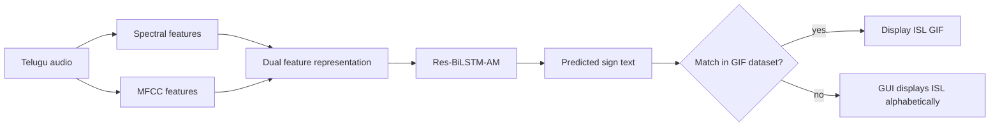
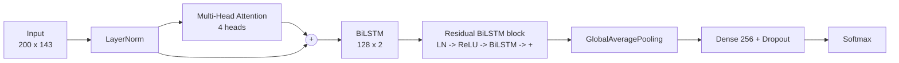

# Paper notes

**Reference:** B. K. V. P. S. Mahalakshmi and S. Anuradha, “Speech-to-Sign Language Translation Framework for Telugu Language using Residual Bidirectional LSTM with Attention Network,” *2025 5th International Conference on Soft Computing for Security Applications (ICSCSA)*, 2025. DOI: [10.1109/ICSCSA66339.2025.11170908](https://doi.org/10.1109/ICSCSA66339.2025.11170908).

**Related documents:** [README](../README.md) · [Architecture](ARCHITECTURE.md) · [Setup guide](SETUP.md) · [Data layout](../data/README.md)

The PDF is included at [paper/speech-to-sign-res-bilstm-am.pdf](paper/speech-to-sign-res-bilstm-am.pdf).

This page is a reading guide and an implementation map. It is not a replacement for the paper.

---

## One-paragraph summary

The paper proposes an end-to-end speech-to-sign translation (S2SLT) system for Telugu. Audio is represented by two complementary feature families: spectral descriptors and MFCCs. Those features feed a **Residual Bidirectional LSTM with Attention Mechanism (Res-BiLSTM-AM)**, which predicts the sign-equivalent text. The predicted text is matched against a predefined ISL GIF database. If a GIF exists, it is displayed as the translation; if not, a GUI shows the ISL output alphabetically so meaning is not lost. The authors report that Res-BiLSTM-AM outperforms LSTM, GRU, BiLSTM and Res-BiLSTM across their evaluation metrics.

---

## Problem framing

- Telugu is widely spoken but underrepresented in assistive technology.
- Telugu and ISL differ in grammar and structure, so word-for-word substitution is not enough.
- Existing systems are often limited by small GIF datasets, weak contextual modelling, vanishing gradients in deep recurrent stacks, and poor handling of noisy/ambiguous speech.
- The paper's response is a hybrid: dual audio features, a residual BiLSTM with attention, and an animation lookup with a GUI fallback.

---

## Proposed pipeline



---

## Model

The paper describes a residual BiLSTM block with layer normalisation and a skip connection:

```text
LayerNorm -> ReLU -> BiLSTM -> Add(skip)
```

The structural figure (Fig. 3) shows:

- an attention layer,
- stacked BiLSTM layers with forward and backward passes,
- ReLU and batch/layer normalisation,
- residual additions,
- concatenation,
- convolutional layers,
- softmax output.

The implementation in this repository follows the readable core of that description:



### Feature contract

| Group | Detail | Count |
|---|---|---:|
| MFCC | 40 coefficients | 40 |
| Delta | first derivative | 40 |
| Delta-delta | second derivative | 40 |
| Spectral | centroid, bandwidth, rolloff, ZCR | 4 |
| Spectral contrast | 7 bands | 7 |
| Chroma | 12 pitch classes | 12 |
| **Total** | | **143** |

### Training setup reported by the paper

| Setting | Value |
|---|---|
| Train/test split | 75% / 25% |
| Optimizer | Adam (implementation default; the paper does not name one) |
| Loss | sparse categorical cross-entropy |
| Epochs | up to 50 in the reported curves |
| Hardware | NVIDIA RTX 3090, CUDA 11.8, cuDNN 8, PyTorch 2.0, Python 3.10 |
| Software mentioned | Python 3.11, Anaconda 3, Windows 11 |

> The paper lists PyTorch 2.0 in its simulation setup. This repository uses TensorFlow/Keras for the model, so training curves and results are not directly comparable.

---

## Data as described

- **Audio:** Free Spoken Digit Dataset (FSDD), 6 speakers, 3,012 recordings, 50 recordings of each numeral per speaker, ~21.15 MB.
- **Animations:** a manually collected GIF set with 50 classes and 500 GIFs.
- The paper's example utterances include:
  - హాయ్ → “Hai”
  - మీరు ఎలా ఉన్నారు → “How are you”
  - నాకు సహాయం కావాలి → “I need help”
  - క్షమించండి → “Sorry”

The repository does **not** ship FSDD or the paper's 500 GIFs. It ships a 214-entry Telugu→ISL mapping and expects an ISL word-level frame corpus.

---

## Reported results

From Table II of the paper:

| Metric | LSTM | GRU | BiLSTM | Res-BiLSTM | Res-BiLSTM-AM |
|---|---:|---:|---:|---:|---:|
| PCC | 0.890 | 0.906 | 0.924 | 0.930 | **0.961** |
| MAE | 0.110 | 0.094 | 0.076 | 0.070 | **0.039** |
| RMSE | 0.332 | 0.307 | 0.275 | 0.265 | **0.196** |
| PSNR | 57.717 | 58.386 | 59.339 | 59.680 | **62.268** |
| CSED | 8.775 | 8.124 | 7.280 | 7.000 | **5.196** |
| STOI | 0.685 | 0.727 | 0.779 | 0.800 | **0.878** |
| PESQ | 0.890 | 0.906 | 0.924 | 0.930 | **0.961** |
| CSII | 149.094 | 125.706 | 106.764 | 97.028 | **52.866** |
| WER | 0.110 | 0.094 | 0.076 | 0.070 | **0.039** |
| ESTOI | 0.779 | 0.821 | 0.874 | 0.895 | **0.972** |

The conclusion highlights **ESTOI 97.2%** as the headline result and argues that residual connections improve convergence and attention improves focus on relevant input segments.

**This repository does not reproduce or claim these numbers.** They depend on the paper's data, preprocessing, training budget and evaluation protocol. Treat them as the paper's reported results, not as a benchmark of this codebase.

---

## Paper vs. this repository

| Paper | This repository | Status |
|---|---|---|
| Telugu audio capture | GUI microphone / file upload / CLI `--audio` | Implemented |
| Spectral + MFCC features | `audio/features.py` — 143 dimensions | Implemented |
| Res-BiLSTM-AM | `model/res_bilstm_am.py` | Implemented, trainable |
| Sign-text prediction | `--mode classify` with a trained checkpoint | Implemented, needs data |
| Text-to-sign mapping | `nlp/translator.py` — dictionary + pivot + fuzzy | Implemented |
| GIF dataset matching | `animation/corpus.py` (frames) + `animation/gif.py` | Implemented, corpus not bundled |
| GUI fallback | `gui/app.py` — text card / alphabet | Implemented |
| Reported metrics | Not reproduced | Not claimed |
| Full ISL grammar | SOV order preserved; no non-manual features | Simplified |
| Continuous signing | Word-level gloss sequence | Out of scope |

### The honest split

- **Runtime path:** Google ASR + dictionary translator + frame playback. Fast, offline-capable for direct hits, no GPU needed.
- **Research path:** dual features + Res-BiLSTM-AM classifier. Matches the paper's model branch, but requires labelled Telugu/ISL audio and training.

The runtime path exists because a trained Telugu acoustic classifier is not shipped. Pretending otherwise would make the demo fragile and the results misleading.

---

## Design decisions worth defending

1. **Dictionary-first translation.** It gives deterministic, inspectable output and works offline. The English pivot is a coverage extension, not the core.
2. **Text fallback over silent failure.** A missing GIF should not erase the sentence. The UI shows the token instead.
3. **Frame corpus over GIF-only.** Frames are easier to index, sort and cache; GIFs remain supported.
4. **Single pipeline object.** The GUI, CLI and tests share one orchestration path, so behaviour cannot drift between interfaces.
5. **Configurable data root.** Large corpora should not live inside a git repository. `S2SL_DATA_DIR` makes that explicit.

---

## Limitations acknowledged by the paper

- Translation quality is bounded by the size and coverage of the GIF dataset.
- The model is trained on Telugu and does not transfer directly to other Indian languages without retraining.
- The paper's future work proposes a larger, more diverse GIF dataset and multilingual support.

## Limitations added by this implementation

- The 214-entry mapping is far smaller than full ISL vocabulary.
- The English pivot can lose Telugu-specific meaning.
- No non-manual features (facial expression, head movement, mouthing).
- No continuous signing; output is a gloss sequence.
- The frame corpus is not bundled, so a fresh clone runs in text-fallback mode until data is added.

---

## Suggested reading order

If you are presenting this work:

1. **Abstract + Introduction** — why Telugu S2SLT matters.
2. **Section III** — data and the importance of the problem.
3. **Section IV** — dual feature extraction.
4. **Section V** — Res-BiLSTM-AM and the animation matching steps.
5. **Section VI + Table II** — results and comparison.
6. **Section VII** — limitations and future scope.

If you are implementing or extending the code:

1. `README.md` — runtime overview.
2. `docs/ARCHITECTURE.md` — components and failure modes.
3. `telugu_s2sl/pipeline.py` — the seam.
4. `telugu_s2sl/audio/features.py` — the feature contract.
5. `telugu_s2sl/model/res_bilstm_am.py` — the paper's model.
