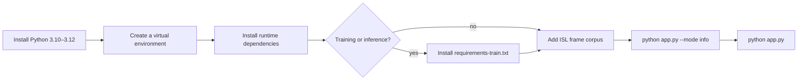

# Setup guide

This guide takes you from a clean machine to a running Telugu → ISL app. It covers Windows, macOS and Linux, the optional TensorFlow training stack, the corpus layout, and the errors that are most likely to slow you down.

**Related documents:** [README](../README.md) · [Architecture](ARCHITECTURE.md) · [Paper notes](PAPER_NOTES.md) · [Data layout](../data/README.md)



---

## 1. Before you begin

### Supported platforms

| Platform | Status | Notes |
|---|---|---|
| Windows 10/11 | Primary | The desktop GUI is developed and tested here |
| macOS 12+ | Supported | Install PortAudio for microphone support |
| Linux (X11/Wayland) | Supported | Install Tk, PortAudio and `libsndfile` |

### Python version

Use **Python 3.10, 3.11 or 3.12**.

- 3.11 is the safest choice for TensorFlow.
- Python 3.13 can run the GUI and the translator, but TensorFlow wheels may not exist yet.
- Check your version:

```bash
python --version
```

On Windows, `py -0p` lists installed interpreters.

### What you need

- ~2 GB free for the runtime environment.
- ~5 GB free if you install TensorFlow and train.
- A working microphone for live recording (optional; file upload and typed text work without one).
- Internet access for Google ASR and the English pivot. Direct dictionary translation and animation playback work offline.
- An ISL frame corpus if you want real animations. Without one, the app runs in text-fallback mode.

---

## 2. Get the code

```bash
git clone <your-repo-url> aiml
cd aiml
```

If you downloaded a ZIP instead, extract it and open a terminal in the folder that contains `app.py`.

---

## 3. Create a virtual environment

A virtual environment keeps the project's packages separate from your system Python.

### Windows (PowerShell)

```powershell
py -3.11 -m venv .venv
.\.venv\Scripts\Activate.ps1
```

If PowerShell blocks activation scripts:

```powershell
Set-ExecutionPolicy -Scope CurrentUser RemoteSigned
```

Then activate again. In `cmd.exe`, use:

```bat
.venv\Scripts\activate.bat
```

### macOS / Linux

```bash
python3.11 -m venv .venv
source .venv/bin/activate
```

You should see `(.venv)` at the start of your prompt. Every command below assumes the environment is active.

---

## 4. Install runtime dependencies

```bash
python -m pip install --upgrade pip
pip install -r requirements.txt
```

This installs:

| Package | Why |
|---|---|
| `SpeechRecognition` | Google speech-to-text |
| `PyAudio` | Microphone capture |
| `deep-translator` | Telugu → English pivot |
| `Pillow` | Frame decoding and GUI images |
| `imageio` | Optional GIF playback |
| `numpy` | Arrays and audio buffers |
| `librosa` | MFCC and spectral features |
| `soundfile` | Audio file I/O |
| `pydub` | Optional audio conversion |

### PyAudio troubleshooting

PyAudio needs the PortAudio C library.

**Windows**

Recent PyAudio releases ship wheels. If `pip install PyAudio` fails:

```powershell
pip install pipwin
pipwin install pyaudio
```

If that also fails, install the matching `.whl` from the PyAudio releases page for your Python version.

**macOS**

```bash
brew install portaudio
pip install pyaudio
```

**Linux (Debian/Ubuntu)**

```bash
sudo apt update
sudo apt install -y portaudio19-dev python3-dev
pip install pyaudio
```

**Linux (Fedora)**

```bash
sudo dnf install portaudio-devel python3-devel
pip install pyaudio
```

### Tkinter

Tkinter ships with the official Windows and macOS Python installers. On Linux it is often a separate package:

```bash
sudo apt install python3-tk
```

---

## 5. Install the training stack (optional)

Only needed for `python app.py --mode train` or `--mode classify`.

```bash
pip install -r requirements-train.txt
```

This adds TensorFlow, Keras, scikit-learn, tqdm and matplotlib.

TensorFlow is large. If you only want the GUI, skip this section. The GUI does not import TensorFlow.

To verify TensorFlow:

```bash
python -c "import tensorflow as tf; print(tf.__version__)"
```

---

## 6. Add the ISL corpus

The repository ships the Telugu mapping (`data/mappings/telugu_to_isl.json`) but **not** the frame corpus, audio recordings or GIFs. Those are large and usually licensed separately.

Put frames here:

```text
data/ISL_Corpus/Frames_Word_Level/
├── HELLO_HI/
│   ├── 001.jpg
│   ├── 002.jpg
│   └── ...
├── THANK/
│   ├── 001.jpg
│   └── ...
└── SCHOOL/
```

Rules:

- The directory name is the gloss used by the mapping (`HELLO_HI`, `THANK`, `SCHOOL`).
- Matching is case-insensitive; `-` and spaces are normalised to `_`.
- Frames are sorted by the first number in the filename. Zero-pad names (`001.jpg`, `002.jpg`) to keep the order stable.
- Supported formats: `.jpg`, `.jpeg`, `.png`.

Then index the corpus:

```bash
python app.py --mode prepare
```

This writes:

```text
data/mappings/isl_corpus_signs.json
data/mappings/isl_corpus_index.json
data/mappings/telugu_to_isl_corpus.json
```

These files are gitignored and can be regenerated at any time.

### Optional: audio for training

The trainer expects an OpenSLR-style layout:

```text
data/audio/
├── female/
│   ├── line_index_female.tsv
│   └── *.wav
└── male/
    ├── line_index_male.tsv
    └── *.wav
```

Each TSV line has two tab-separated columns:

```text
file_id<TAB>Telugu sentence
```

The trainer matches transcripts to the 214-word vocabulary and extracts features from matching files. With fewer than 10 audio files it uses synthetic data for a smoke test.

### Optional: GIF library

The paper describes a GIF dataset. The runtime prefers the frame corpus, but GIFs work too:

```text
data/gifs/
├── alphabets/
├── numbers/
└── words/
```

Any `.gif` placed anywhere under `data/gifs/` is discovered by stem name.

---

## 7. Run the app

```bash
python app.py
```

Windows shortcut:

```text
scripts\run_app.bat
```

macOS / Linux shortcut:

```bash
./scripts/run_app.sh
```

If the script is not executable:

```bash
chmod +x scripts/run_app.sh
./scripts/run_app.sh
```

The app opens a 1200×800 window with:

- **Left panel** — Record, Upload, Telugu text input, recognised text, ISL translation.
- **Right panel** — 400×400 animation display, Play/Pause, Stop, Reset, sign sequence.
- **Status bar** — recording, processing, playback and fallback messages.

### First run checklist

```bash
python app.py --mode info
```

Expected output shape:

```text
mappings        240
corpus_signs    0
corpus_frames   0
asr_backend     google
```

- `mappings` around 240 means the seed vocabulary plus the 214-entry mapping loaded.
- `corpus_signs: 0` means no frames are indexed; the app will show text fallbacks. Add the corpus and rerun `--mode prepare`.
- `asr_backend: google` means `SpeechRecognition` imported successfully.

If `asr_backend` says `unavailable`, install the runtime requirements.

---

## 8. CLI usage

```bash
# Text -> ISL gloss
python app.py --translate "నమస్కారం ధన్యవాదాలు"

# Audio file -> transcript -> ISL gloss
python app.py --audio samples/greeting.wav

# Corpus index
python app.py --mode prepare

# Runtime summary
python app.py --mode info

# Tests
python app.py --mode test
```

`--audio` accepts WAV, MP3, FLAC and OGG. WAV-like files go straight to SpeechRecognition; other formats are decoded with librosa first.

---

## 9. Training and classification

```bash
pip install -r requirements-train.txt
python app.py --mode train
```

The trainer:

1. Loads the mapping and filters it to signs that exist in the corpus (or keeps all classes if no corpus is present).
2. Reads `line_index_*.tsv` transcripts and matches audio files to vocabulary words.
3. Extracts 143-dimensional dual features and pads/truncates to 200 frames.
4. Splits 75% train / 25% test.
5. Trains Res-BiLSTM-AM with early stopping and a checkpoint.
6. Saves the model, training history, and `class_mapping.json` under `models/trained/`.

Classify a clip:

```bash
python app.py --mode classify --audio path/to/clip.wav
```

If there is no checkpoint, you will get a clear `FileNotFoundError` telling you to run training first. That is expected.

### Synthetic data warning

If the trainer cannot find enough audio, it generates separable random features. This is only a **pipeline smoke test**. The resulting accuracy says nothing about real Telugu recognition. Do not report synthetic results as model performance.

---

## 10. Environment variables

| Variable | Default | Purpose |
|---|---|---|
| `S2SL_DATA_DIR` | `<repo>/data` | Move the corpus/audio/gifs to another drive |
| `S2SL_MODELS_DIR` | `<repo>/models` | Store checkpoints outside the repo |

Example (PowerShell):

```powershell
$env:S2SL_DATA_DIR = "D:\datasets\telugu-s2sl"
python app.py
```

Example (bash):

```bash
export S2SL_DATA_DIR=/mnt/data/telugu-s2sl
python app.py
```

The directory must contain the same `mappings/`, `audio/`, `gifs/` and `ISL_Corpus/` structure.

---

## 11. Microphone and privacy notes

- The app calibrates ambient noise for roughly one second before listening.
- Google Speech Recognition receives the recorded phrase. Do not use sensitive audio on a shared network if that is a concern.
- The English pivot sends individual Telugu tokens to Google Translate. Direct dictionary hits do not leave the machine.
- Audio uploaded for transcription is processed in memory; the app does not write a permanent copy.

---

## 12. Troubleshooting

| Error / symptom | Cause | Fix |
|---|---|---|
| `python: command not found` | Python not on PATH | Use `py` on Windows or install Python from python.org |
| `ModuleNotFoundError: No module named 'telugu_s2sl'` | Running from the wrong folder | `cd` to the folder containing `app.py` |
| `ModuleNotFoundError: speech_recognition` | Runtime deps missing | `pip install -r requirements.txt` |
| `ModuleNotFoundError: tensorflow` | Training deps missing | `pip install -r requirements-train.txt` |
| `PyAudio` build error | PortAudio missing | See §4 |
| `OSError: [Errno -9996] Invalid input device` | No default microphone | Set a default input device in the OS sound settings |
| `OSError: [Errno -9999] Unanticipated host error` | Mic busy or permission denied | Close other apps; allow microphone access |
| `[API లోపం - API Error]` | Google endpoint unreachable | Check internet, proxy, firewall |
| `No ISL frame corpus found` | No frames in `data/ISL_Corpus/Frames_Word_Level` | Add frames or accept text fallback |
| All signs show as text cards | Corpus empty or gloss names don't match | Run `--mode prepare`; check directory names |
| Animation is blank | Frame files unreadable | Verify JPEG/PNG files open in an image viewer |
| Telugu appears as boxes | Font missing | Install a Telugu font (e.g. Noto Sans Telugu) |
| Garbled console text on Windows | Legacy code page | Use Windows Terminal or `chcp 65001` |
| `TclError: no display name` | Running GUI over SSH/headless | Use a desktop session or the CLI modes |
| `FileNotFoundError: Model not found` | No trained checkpoint | Run `python app.py --mode train` |
| TensorFlow warns about CPU instructions | Normal on some CPUs | Ignore unless it aborts |
| `pip` is very slow | Large TensorFlow wheel | Use a wired connection; install runtime deps first |

### Resetting the environment

```bash
deactivate
rm -rf .venv        # macOS / Linux
# Remove-Item -Recurse -Force .venv   # Windows PowerShell
```

Then repeat §3–§4.

---

## 13. IDE setup (optional)

### VS Code

Recommended extensions:

- Python
- Pylance
- Markdown Preview Mermaid Support (to render the diagrams locally)

Select the `.venv` interpreter:

1. `Ctrl+Shift+P` → **Python: Select Interpreter**
2. Choose `.venv\Scripts\python.exe` (Windows) or `.venv/bin/python` (macOS/Linux)

### PyCharm

1. **Settings → Project → Python Interpreter**
2. **Add Interpreter → Existing**
3. Select `.venv\Scripts\python.exe` or `.venv/bin/python`

---

## 14. What success looks like

- `python app.py --mode info` reports mappings and an ASR backend.
- `python app.py --translate "నమస్కారం"` prints `hello_hi` (or `hello`, depending on the mapping file).
- `python app.py` opens the window.
- With a corpus, signing frames play at roughly 10 fps.
- Without a corpus, the right panel shows a text card for the missing sign instead of crashing.
- `pytest -q` passes without network access.

If all of that is true, the installation is complete.
